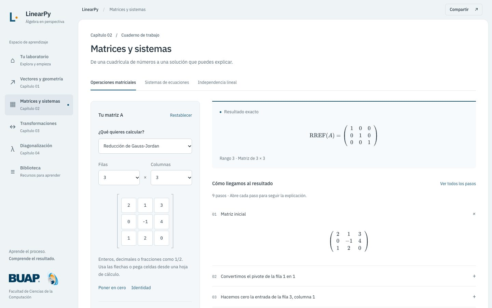

# LinearPy

**[Abrir LinearPy →](https://linearpy.jorgesm03047.workers.dev)**

**Explora el álgebra lineal paso a paso.** LinearPy es un laboratorio web interactivo para visualizar conceptos, resolver ejercicios y entender el razonamiento que conecta cada operación.

[Ver condiciones de uso](TERMINOS-DE-USO.md)



[Ver la experiencia móvil](docs/previews/mobile.png)

## Explora

- **Vectores y geometría:** normas, productos, ángulos, rectas, planos y una escena 3D que puedes explorar con ratón, tacto o teclado.
- **Matrices y sistemas:** determinantes, inversas, eliminación de Gauss-Jordan, clasificación de sistemas e independencia lineal.
- **Transformaciones lineales:** núcleo, imagen, rango, nulidad y visualización 2D de rotaciones, escalas, cizallamientos y reflexiones.
- **Diagonalización:** polinomio característico, autovalores, espacios propios y factorización cuando se puede calcular exactamente.
- **Biblioteca:** recursos audiovisuales organizados por tema.

En cada espacio puedes editar los datos, revisar el resultado y desplegar el procedimiento a tu ritmo. La interfaz se adapta a teléfonos, tabletas y computadoras. Los editores aceptan fracciones exactas y pegado de celdas desde una hoja de cálculo.

## Comparte y continúa

Los ejercicios se pueden compartir mediante un enlace o un código QR. Los borradores se guardan en el almacenamiento local del navegador; no hay cuentas de estudiantes ni una base de datos que recoja sus ejercicios.

## Precisión

El motor conserva fracciones exactas y ciertos radicales. Cuando una operación usa aproximaciones —como algunos ángulos, representaciones geométricas o raíces de polinomios— la interfaz las identifica. La diagonalización exacta se limita a casos con autovalores racionales calculables por el motor; alcanzar un límite de búsqueda no demuestra que una raíz sea irracional.

## Condiciones de uso e identidad visual

LinearPy es un proyecto educativo independiente. Las imágenes de BUAP y FCC se incluyen solo como referencia visual del contexto académico: el sitio no representa a esas instituciones ni implica su afiliación, aval o respaldo. Las marcas y logotipos pertenecen a sus titulares. Este aviso no sustituye las autorizaciones que pudieran requerirse para usar la identidad gráfica institucional; consulta el [Manual de Identidad Gráfica de BUAP](https://comunicacion.buap.mx/sites/default/files/IdentidadGrafica/manual-identidad-buap.pdf). Los resultados son material de apoyo y conviene verificarlos antes de usarlos en una entrega.

Lee las [condiciones breves de uso](TERMINOS-DE-USO.md).

## Proyecto

LinearPy fue creado por Jorge David Santos Marquez. El código fuente está disponible bajo licencia MIT; los logotipos y demás marcas institucionales no forman parte de esa licencia.

Para ejecutar una copia de desarrollo se requiere Node.js 24 o superior:

```bash
npm ci
npm run dev
```

El comando `npm run build` genera el sitio en `dist`. Las comprobaciones del proyecto están disponibles con `npm test`, `npm run format:check` y `npm run check:comments`.
